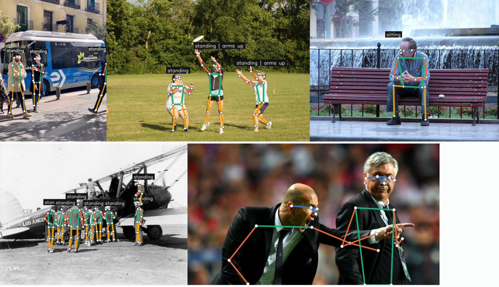
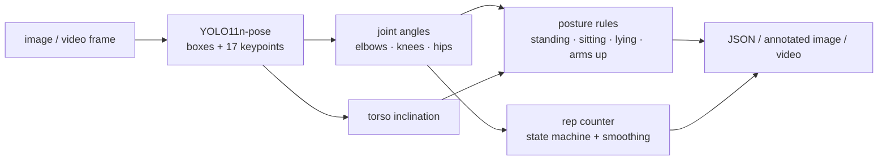
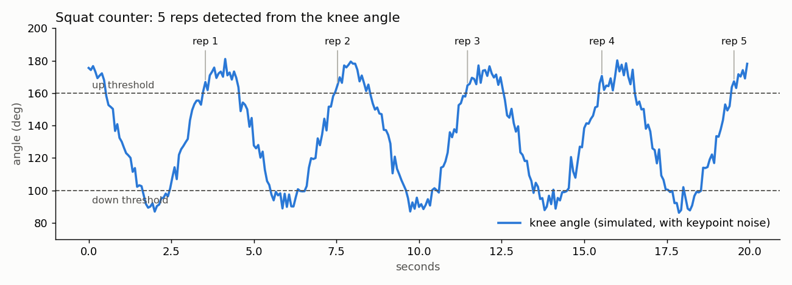
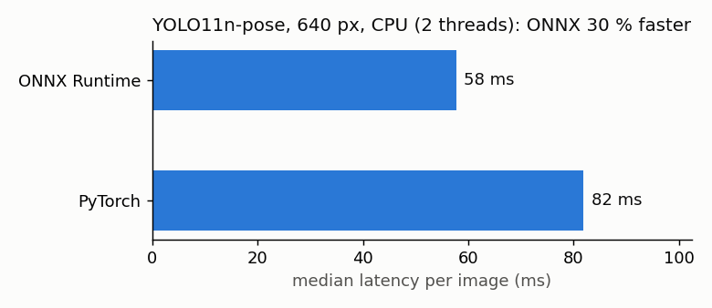

# Human pose estimation & skeleton analytics (YOLO11-pose · OpenCV · ONNX · FastAPI)


Detects every person in an image or video, estimates their **skeleton (17 COCO keypoints)**
and turns it into usable signals: **joint angles**, **posture** (standing / sitting / lying),
**arms raised**, and an **exercise repetition counter**. Served as a REST API in Docker, with an
ONNX export for faster CPU inference.

> 🇫🇷 Détection de squelette humain (17 points clés) avec YOLO11-pose : angles articulaires,
> posture, bras levés, comptage de répétitions, API FastAPI conteneurisée, export ONNX et CI.



*Colour code: head in blue, arms in orange, torso in green, legs in yellow. Images: Ultralytics
samples and the COCO dataset.*

## What it does



| Module | Content |
|---|---|
| `posekit/detector.py` | YOLO11-pose wrapper (PyTorch or ONNX weights), returns people with keypoints, angles, posture |
| `posekit/geometry.py` | joint angles, torso inclination, posture rules |
| `posekit/reps.py` | repetition counter (hysteresis thresholds + moving average against keypoint jitter) |
| `posekit/draw.py` | skeleton rendering with OpenCV |
| `posekit/api.py` | FastAPI: `POST /pose` (JSON), `POST /pose/image` (annotated JPEG), `GET /health` |
| `posekit/cli.py` | batch processing of images and videos (videos get the rep counter overlay) |

## Results

**Repetition counting.** The counter only counts full cycles (down, then up again) and ignores
partial movements and lost keypoints:



**CPU inference, PyTorch vs ONNX Runtime** (same model, 640 px, measured with
`scripts/benchmark.py`, median over 30 runs on 2 CPU threads):



**Model accuracy.** YOLO11n-pose is reported by Ultralytics at 50.0 mAP<sup>pose</sup> 50-95
on COCO val2017, with 2.9 M parameters, which makes it small enough for CPU and edge devices.

### Limitations (and next steps)

Posture comes from 2D geometric rules, which are transparent and need no training data, but:

- a person **sitting and facing the camera** can look "standing" in 2D (the thighs point at the
  camera, so the hip angle stays open);
- people cut by the image border get no posture label.

Next step: train a small classifier on keypoint features (angles, limb ratios) with labelled
examples, or use temporal smoothing on video.

## Quick start

```bash
pip install -r requirements.txt
python -m posekit.cli samples/bus.jpg samples/zidane.jpg --out output   # images
python -m posekit.cli squat.mp4 --out output                             # video + rep counter
```

API with Docker:

```bash
docker build -t pose-api . && docker run -p 8000:8000 pose-api
curl -F "file=@samples/bus.jpg" http://localhost:8000/pose
curl -F "file=@samples/bus.jpg" http://localhost:8000/pose/image -o annotated.jpg
```

```json
{"count": 4, "latency_ms": 81.5, "people": [
  {"box": [48.0, 399.9, 243.5, 905.9], "score": 0.887, "posture": "standing", "arms_raised": false,
   "torso_inclination_deg": 0.6,
   "angles": {"left_elbow": 11.3, "left_knee": 168.0, "left_hip": 160.7,
              "right_elbow": 70.6, "right_knee": 171.0, "right_hip": 175.3},
   "keypoints": [[x, y, confidence], "... 17 points"]}, "..."]}
```

## Tests and CI

```bash
pip install -r requirements-dev.txt
pytest -q                       # geometry, posture rules, rep counter, API on a real image
python scripts/benchmark.py     # PyTorch vs ONNX latency
python scripts/make_figures.py  # README figures
```

GitHub Actions: lint, tests, demo run (outputs uploaded as an artifact), Docker build and a
smoke test of the running API.

## Author

**Asma Kerkouri** · DevOps & AI engineer · [LinkedIn](https://www.linkedin.com/in/asma-kerkouri-443b6815a)
